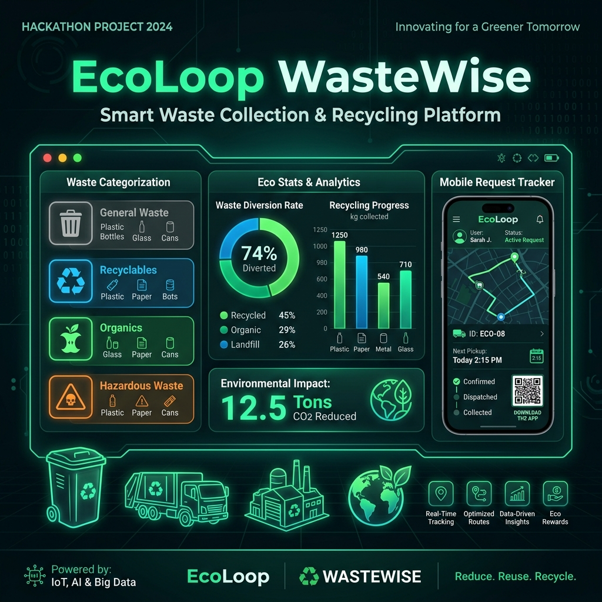

# 📌 PROJECT POSTER: EcoLoop Smart Waste Collection & Recycling Platform

**FIT-FEST 2026 HACKATHON**  
**Flora Institute of Technology | GDG FIT Pune | Hack2skill**



---

## 🔍 1. Real-World Problem
- **Improper Waste Disposal**: Citizens struggle to segregate household waste (e.g. hazardous waste vs. recyclables vs. e-waste) and lack clear information on local collection services.
- **Unorganized Collection Workflow**: Waste management teams lack digital request management tools, real-time driver tracking, and city-wide recycling volume statistics.
- **Lack of Incentive**: Citizens lack visible environmental feedback (carbon offset metrics, reward badges) when disposing of waste responsibly.

---

## 🚀 2. Proposed Solution: EcoLoop Platform
EcoLoop is a lightweight, responsive software application featuring:
1. **Interactive Citizen Request Portal**: Doorstep pickup request form with waste category selection, quantity slider, time slot scheduling, and Leaflet OpenStreetMap location pin drop.
2. **Real-Time Progress Tracker**: Live progress timeline (`Placed` ➔ `Scheduled` ➔ `En Route` ➔ `Picked Up` ➔ `Recycled`) with instant receipt downloads.
3. **Administrative Control Center**: Filterable table for dispatching collection vehicles, updating request statuses, and analyzing waste collection metrics via Chart.js visualizations.
4. **Gamified Eco Impact**: Real-time calculation of Eco-Points earned and kg CO₂ offset per pickup.

---

## 🛠️ 3. Major Features & Architecture

```
                       +-----------------------------------+
                       |      EcoLoop Web App Interface    |
                       +-----------------------------------+
                                         |
     +-----------------------------------+-----------------------------------+
     |                                   |                                   |
     v                                   v                                   v
+------------------------+   +------------------------+   +------------------------+
| ♻️ Category & Disposal |   | 📍 Location & Leaflet  |   | 👨‍💼 Admin Dashboard    |
|   Guidelines Engine    |   |   Map Pin Picker       |   |   & Dispatch Table     |
+------------------------+   +------------------------+   +------------------------+
     |                                   |                                   |
     +-----------------------------------+-----------------------------------+
                                         |
                                         v
                       +-----------------------------------+
                       |  Python Flask REST API Server     |
                       |  (Gunicorn WSGI + Dockerized)     |
                       +-----------------------------------+
                                         |
                                         v
                       +-----------------------------------+
                       |   Google Cloud Run Deployment     |
                       +-----------------------------------+
```

---

## 📊 4. Key Metrics & Impact
- **8 Recyclable Waste Categories**: Plastic, E-Waste, Organic, Paper, Glass, Metals, Hazardous, Bulk.
- **Instant Eco-Impact Calculation**: Real-time formula mapping weight to CO₂ avoided ($kg CO_2 = weight \times factor$).
- **Cloud Native Architecture**: Docker containerized with Gunicorn web server, fully deployable to **Google Cloud Run** in minutes.

---

## 📣 5. Submission Checklist
- [x] **Source Code**: Clean, documented Python Flask & HTML5/CSS3/JS application.
- [x] **Dockerfile**: Configured with Python 3.12-slim & Gunicorn for Cloud Run.
- [x] **Project Poster**: Graphic banner asset generated & documented.
- [x] **Social Media Post Content**: Prepared with official handles (`@gdg.fit.pune`, `@the_flora_institutes`) and hashtags (`#FITFEST2026`, `#FITFESTHACKATHON`, etc.).
