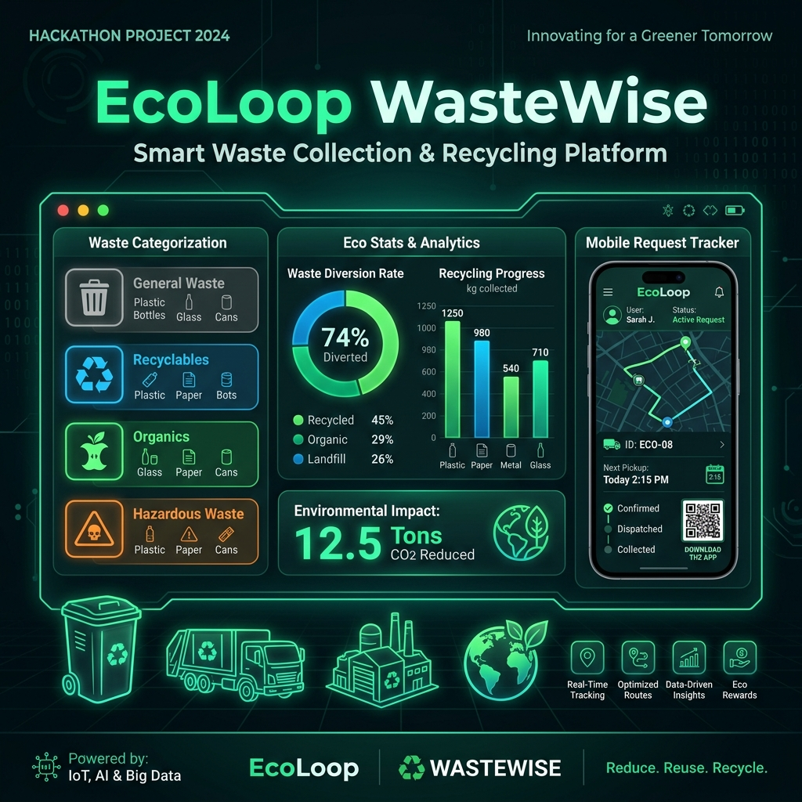

# ♻️ EcoLoop - Smart Waste Collection & Recycling Platform

> **FIT-FEST 2026 HACKATHON SUBMISSION**  
> **Challenge:** Smart Waste Collection & Recycling Platform  
> **Participant:** Anushka Shinde (+91 7045782996 | flora.education@gmail.com)  
> **Organizers:** Flora Institute of Technology | GDG FIT Pune | Hack2skill  



---

## 🌟 Executive Overview

**EcoLoop** is an intelligent, full-stack web-based waste collection management and recycling platform designed to bridge the gap between environmentally conscious citizens and municipal/private waste collection management services. 

### 🎯 Problem Statement
People frequently face difficulty understanding how to properly segregate and dispose of different waste categories (E-waste, plastics, organic, hazardous items) or requesting timely pickup services. Simultaneously, collection services struggle to systematically organize pickup requests, optimize routes, and report recycling statistics.

### 💡 Solution
EcoLoop provides an intuitive user interface for citizens to request waste pickup, track request progress via live interactive timelines, calculate real-time environmental impact (CO₂ saved and Eco-Points earned), and offers administrative authorities a dashboard to manage dispatching, update request statuses, and analyze collection statistics.

---

## 🔥 Key Features Implemented

- ♻️ **Waste Category Selection & Disposal Guidance**: 8 curated waste categories (Plastics, E-Waste, Organic, Paper, Glass, Metals, Hazardous, Bulk) with instant recycling advice and disposal tips.
- 📍 **Interactive Location & Geolocation**: Address input paired with an interactive Leaflet OpenStreetMap location pin picker and HTML5 GPS integration.
- 📝 **Pickup Request Submission**: Quantity/weight slider (0.5kg - 50kg), landmark notes, contact details, auto-calculating CO₂ offset, and Eco-Points calculation.
- 📅 **Pickup Scheduling**: Date selector and 3 daily time window slots (Morning 9am-12pm, Afternoon 12pm-3pm, Evening 3pm-6pm).
- 🔄 **Real-Time Request Tracker**: Interactive progress timeline tracking 5 stages: `Placed` ➔ `Scheduled` ➔ `En Route` ➔ `Picked Up` ➔ `Recycled`.
- 👨‍💼 **Administrative Dashboard**:
  - Live filterable data table (Filter by status, search by Request ID, name, or location).
  - One-click status updates (`Pending`, `Scheduled`, `En Route`, `Picked Up`, `Recycled`).
  - Driver & collection unit dispatch assignment.
- 📊 **Collection Statistics & Visual Analytics**:
  - Interactive Chart.js breakdown of collected waste by category.
  - Monthly recycling trends and carbon emission avoidance metrics.
- 📋 **Printable Eco-Receipts & User History**: Instant PDF/Printable receipt generation with eco-impact breakdown.

---

## 🛠️ Technology Stack

| Layer | Technology |
| :--- | :--- |
| **Backend REST API** | Python 3.12, Flask 3.1.3 |
| **Production Server** | Gunicorn (Multi-threaded WSGI worker) |
| **Frontend Framework** | HTML5, Vanilla CSS3 (Custom Glassmorphism Design System) |
| **UI Components & Styling** | Tailwind CSS, FontAwesome 6 Icons |
| **Maps & Location** | Leaflet.js, OpenStreetMap API |
| **Analytics & Data Vis** | Chart.js |
| **Containerization** | Docker, Google Cloud Run Ready |

---

## 🚀 Local Setup & Installation Instructions

### Prerequisites
- Python 3.10+ (or Docker)
- Git

### Step-by-Step Running Locally

1. **Clone the Repository:**
   ```bash
   git clone https://github.com/AnushkaShinde/smart-waste-collection-platform.git
   cd smart-waste-collection-platform
   ```

2. **Install Python Dependencies:**
   ```bash
   pip install -r requirements.txt
   ```

3. **Run the Development Server:**
   ```bash
   python app.py
   ```

4. **Access the Web Application:**
   Open your browser and navigate to: `http://localhost:8080`

---

## ☁️ Google Cloud Run Deployment Guide

EcoLoop is packaged with a multi-stage, production-ready `Dockerfile` optimized for **Google Cloud Run**.

### Step 1: Install & Initialize Google Cloud SDK
```bash
gcloud auth login
gcloud config set project YOUR_GCP_PROJECT_ID
```

### Step 2: Build & Submit Docker Image to Artifact Registry / Container Registry
```bash
gcloud builds submit --tag gcr.io/YOUR_GCP_PROJECT_ID/ecoloop-app:v1 .
```

### Step 3: Deploy to Google Cloud Run
```bash
gcloud run deploy ecoloop-app \
  --image gcr.io/YOUR_GCP_PROJECT_ID/ecoloop-app:v1 \
  --platform managed \
  --region asia-south1 \
  --allow-unauthenticated \
  --port 8080
```

Once deployed, Google Cloud Run will issue your HTTPS live application URL:  
`https://ecoloop-app-xxxxx-uc.a.run.app`

---

## 📱 Social Media & Poster Submission Details

### LinkedIn & Instagram Post Template

> 🚀 Excited to present **EcoLoop - Smart Waste Collection & Recycling Platform**, built for the **FIT-FEST 2026 HACKATHON** hosted by Flora Institute of Technology in collaboration with GDG FIT Pune & Hack2skill!
>
> 🌍 **Problem:** Citizens face challenges in categorizing waste and scheduling proper disposal, while collection services struggle to manage pickup requests efficiently.
> 
> 💡 **Solution:** EcoLoop provides interactive waste category guidance, doorstep pickup scheduling with live map tracking, real-time CO₂ offset calculation, and an admin dispatch dashboard with visual recycling analytics!
>
> 🛠️ **Tech Stack:** Python Flask, HTML5/CSS3 Glassmorphism UI, Leaflet Maps, Chart.js, Docker & Google Cloud Run.
>
> 🌐 **Live Demo:** [Google Cloud Run Application Link]  
> 🔗 **GitHub Repo:** [Public Repository Link]
>
> Mentions:
> @gdg.fit.pune @the_flora_institutes Flora Institute of Technology
>
> Hashtags:  
> #FITFEST2026 #FITFESTHACKATHON #GDGFITPUNE #GDGPUNE #FLORAINSTITUTES #FLORAINSTITUTEOFTECHNOLOGY #HACKATHON2026 #PUNEHACKATHON #STUDENTHACKATHON #SOLOHACKATHON #TECHHACKATHON

---

## 📜 License & Acknowledgments

- **Hackathon:** FIT-FEST 2026 HACKATHON
- **Institution:** Flora Institute of Technology & GDG FIT Pune
- **Platform:** Hack2skill
- **Author:** Anushka Shinde (2026)
